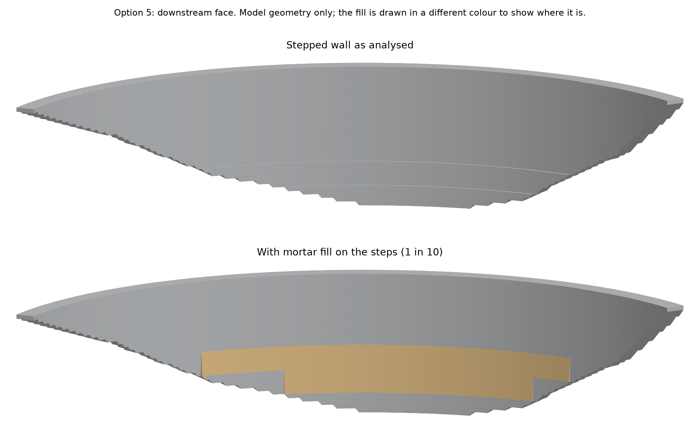
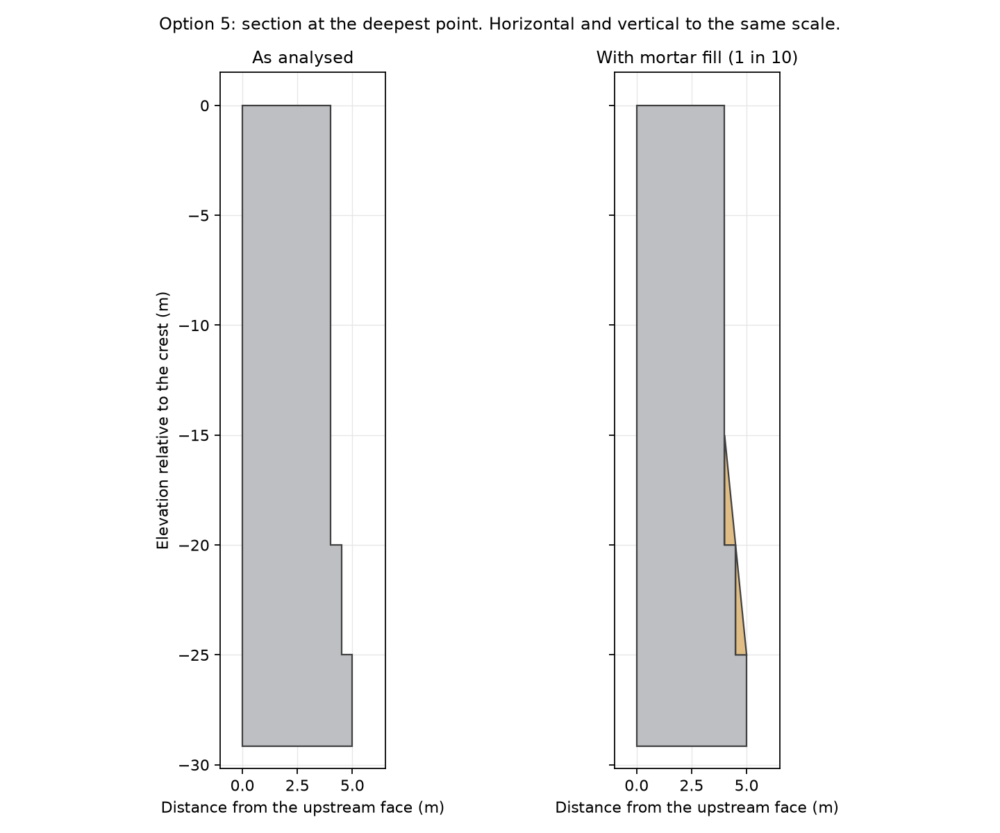

# Gairezi Dam: comparison of seven wall options under a full reservoir

13 November 2026. Prepared from the model sweep of 12 November 2026.

**Status: preliminary model comparison.** These are results of a computer model with generic
values for several inputs. They compare options against each other. They are not an engineering
assessment of the dam and have not been independently reviewed.

## Summary

- **Seven wall options were analysed** under the dam's own weight and a reservoir standing
  3 m above the crest: four uniform thicknesses (4 m to 5.5 m) and three versions of the 4 m
  wall thickened in steps near its base.
- **No option reaches the 2 mm opening** at the contact between the wall and its foundation.
  The largest is 1.58 mm (option 7). The uniform walls stay at or below 1.13 mm.
- **No option exceeds the concrete's strength in the reference analysis.** The 4 m wall has
  the least margin: peak tension 1.78 MPa against a strength of 2.0 MPa. The second solver
  puts the 4 m wall and option 6 at the limit (2.03 and 1.99 MPa).
- **A thicker uniform wall improves every measure**, at about 1,600 m3 of concrete (12%) for
  each extra half metre.
- **Steps near the base are cheap but a trade-off.** For 3 to 4% more concrete they lower the
  peak tension in the wall by up to 17%, but they increase the opening at the base by 13 to 40%.
- **Temperature is not in these results and is likely to govern.** A separate trial on the
  4 m wall indicated that cooling the wall by a few degrees is enough to pass both limits.
- **The steps can be kept and still give a smooth downstream face.** A sloped mortar fill on
  each step hides it, for 100 to 256 m3 of mortar depending on the option (pictures below). A
  first check on option 5 changed the structural results by about 1%. The full-size runs with
  the fill have not been made yet.
- **Four inputs are needed before any option can be judged**; they are listed at the end.

## Results

Worst case of the two joint conditions analysed (water pressure acting in the open contact),
reference solver. Percentages are of the limit: 2.0 MPa tensile strength, 2 mm opening.

| Option | Wall thickness | Concrete (m3) | Extra over option 1 | Peak wall tension (MPa) | Largest opening at the base (mm) |
|---|---|---|---|---|---|
| 1 | 4 m | 13,348 | - | 1.78 (89%) | 1.13 (57%) |
| 2 | 4.5 m | 14,942 | +1,594 m3 (+11.9%) | 1.45 (73%) | 0.96 (48%) |
| 3 | 5 m | 16,530 | +3,182 m3 (+23.8%) | 1.13 (56%) | 0.80 (40%) |
| 4 | 5.5 m | 18,180 | +4,832 m3 (+36.2%) | 0.89 (44%) | 0.67 (34%) |
| 5 | 4 m, 4.5 m below 20 m depth, 5 m below 25 m depth | 13,913 | +565 m3 (+4.2%) | 1.59 (80%) | 1.49 (75%) |
| 6 | 4 m, 4.5 m below 20 m depth | 13,707 | +359 m3 (+2.7%) | 1.77 (88%) | 1.28 (64%) |
| 7 | 4 m, 5 m below 25 m depth | 13,706 | +358 m3 (+2.7%) | 1.48 (74%) | 1.58 (79%) |

Peak compression in the wall is no more than 3.7 MPa in the reference solver and 4.8 MPa in
the second solver, against a strength of 30 MPa. Peak movement of the wall, with
the base free to open, is 7.8 to 11.8 mm. The full figures are in the appendix.

## What the results show

1. **Uniform walls.** Going from 4 m to 4.5 m lowers peak tension by 19% and the opening by
   15%. Going to 5.5 m halves the tension and lowers the opening by 40%, for 36% more concrete.
2. **Stepped walls.** Option 7 (5 m thick over the lowest 4 m) brings the peak tension down
   to 1.48 MPa, about the level of the 4.5 m wall (1.45 MPa), with 358 m3 of extra concrete
   instead of 1,594 m3. Its opening at the base is the largest of the seven (1.58 mm). Option 6
   (a single step higher up) changes the peak tension by 1% only.
3. **Where the contact opens.** In all seven options the largest opening is at the upstream
   edge of the wall's base, at the bottom of the valley. Between 15% and 25% of the contact
   area opens.
4. **Water in the open contact matters.** It increases the opening by 0.25 to 0.39 mm in every
   option.

## Keeping the steps, with a smooth downstream face

The stepped options (5, 6 and 7) leave a horizontal ledge on the downstream face at each
step. A mortar fill on each ledge, sloped back to meet the wall face above it, hides the
ledge. The fill is for appearance: the wall and its steps stay as analysed, and the fill is
not counted on to carry load.

| Option | Steps | Where the fill sits | Mortar (m3) |
|---|---|---|---|
| 5 | 0.5 m at 20 m depth and 0.5 m at 25 m depth | One slope from 25 m up to 15 m depth | 167 |
| 6 | 0.5 m at 20 m depth | From 20 m up to 15 m depth | 101 |
| 7 | 1 m at 25 m depth | From 25 m up to about 15 m depth | 256 |

The slope is 1 horizontal to 10 vertical in all three and can be changed. The mortar is in
addition to the concrete volumes in the results table. Pictures of options 6 and 7 are in
`client-report-figures/`.

What has been checked, and what has not:

- **The fill is in the structural model**, as a separate soft material bonded to the wall
  face, with its own weight (about 370 t for option 5). So the analysis includes its effect
  on the wall instead of assuming it has none.
- **First check, option 5.** With the fill, the peak tension in the wall changed by less than
  0.5% and the largest opening at the base was about 1% smaller. This check used a coarser
  mesh than the results table (elements twice the size), so it shows the size of the effect,
  not final figures.
- **Not run yet.** The full-size analyses of options 5, 6 and 7 with the fill. They are set
  up as runs 8 to 10 of the same sweep.
- **Not modelled.** Cracking of the fill, the fill coming away from the wall, its behaviour
  under temperature changes, and its durability.
- **Assumed.** The mortar's weight (2,200 kg/m3) and stiffness (1% of the concrete's). Values
  for the intended mortar are needed, with the preferred slope.

## What was modelled

- **Dam.** An arch wall with an upstream radius of 80 m, about 168 m long at the crest and up
  to 29 m high, on a 1 m concrete foundation on bedrock. The bedrock profile is the surveyed one.
- **Loads.** Self-weight, reservoir 3 m above the crest, tailwater 3 m deep. Nothing else.
- **Concrete.** Stiffness 35 GPa, tensile strength 2 MPa, compressive strength
  30 MPa, as set in the project configuration.
- **Three analyses per option.** Two independent solvers (Elmer and Code_Aster) with the wall
  held to its foundation by stiff springs that cannot open. Then Code_Aster again with the contact between
  wall and foundation free to open and slide, following Code_Aster's standard method for dam
  joints, once dry and once with water pressure in the contact. Code_Aster is the project's
  reference solver.
- **Steps.** Modelled as cast in one piece with the wall.

## What these results do not cover

- **Temperature.** Not applied. In a separate trial on the 4 m wall, with an assumed
  stress-free temperature of 16 C and a generic expansion coefficient, the peak tension
  reached 2.0 MPa with the wall at about 14 C, and the opening reached 2 mm at about 10 to
  12 C. Those inputs are assumptions, so the figures are indicative only.
- **Earthquake, and any flood level other than 3 m over the crest.** Not analysed.
- **Cracking inside the wall.** The wall is modelled as intact concrete. Only the contact at
  its base can open. Where tension is near the limit, the model does not show what cracking
  would do.
- **The contact between the foundation and the bedrock.** It cannot open in this model.
- **Contact properties.** Friction and adhesion at the wall/foundation contact are generic
  values from Code_Aster's documentation and test cases, not measured for this site.
- **Mesh.** One mesh per option. A check on a coarser mesh gave openings about 20% smaller
  for the 4 m wall, so the openings depend on element size. A finer mesh has not been run.
- **Agreement between the solvers.** They agree on wall movement to within 1%. On peak
  tension Elmer is 20 to 46% higher than Code_Aster, and for option 7 it is 44% higher on
  peak compression. This difference has not been resolved.

## Inputs and decisions needed

1. **Concrete temperatures.** The temperature at which the wall is stress-free, the seasonal
   range of the concrete (monthly means for the site), and the expansion coefficient.
2. **Acceptance criteria.** Whether 2 mm at the wall/foundation contact is the governing limit,
   and which tension figure is to be compared with the 2.0 MPa strength.
3. **How the steps would be built.** Cast in one piece with the wall, as assumed here, or with
   a construction joint at each step. With joints modelled between the parts, an earlier run
   gave larger openings (up to 2.2 mm for option 5).
4. **Properties of the wall/foundation contact.** Friction and any tensile bond.

With those, the same sweep can be repeated. All seven options ran in 110 minutes.

## Appendix: full figures

Stresses in MPa, movements and openings in mm. "Fixed base" is the wall held to its
foundation; "open base" is the contact free to open, dry or with water pressure in it.

| Option | Tension, fixed base, Code_Aster | Tension, fixed base, Elmer | Tension, open base, dry | Tension, open base, water | Compression, fixed base, Code_Aster | Compression, fixed base, Elmer | Compression, open base, water | Wall movement, fixed base | Wall movement, open base, water | Opening, dry | Opening, water | Contact area opened, water |
|---|---|---|---|---|---|---|---|---|---|---|---|---|
| 1 | 1.64 | 2.03 | 1.75 | 1.78 | 3.23 | 3.35 | 3.39 | 10.3 | 11.8 | 0.88 | 1.13 | 19% |
| 2 | 1.34 | 1.60 | 1.41 | 1.45 | 2.95 | 3.05 | 3.09 | 9.0 | 10.2 | 0.71 | 0.96 | 17% |
| 3 | 1.03 | 1.26 | 1.09 | 1.13 | 2.69 | 2.79 | 2.80 | 8.0 | 8.8 | 0.54 | 0.80 | 17% |
| 4 | 0.80 | 0.98 | 0.83 | 0.89 | 2.47 | 2.57 | 2.56 | 7.1 | 7.8 | 0.40 | 0.67 | 15% |
| 5 | 1.24 | 1.65 | 1.47 | 1.59 | 2.98 | 3.09 | 3.18 | 9.6 | 11.5 | 1.13 | 1.49 | 25% |
| 6 | 1.51 | 1.99 | 1.68 | 1.77 | 3.10 | 3.22 | 3.28 | 9.9 | 11.6 | 0.98 | 1.28 | 21% |
| 7 | 1.23 | 1.80 | 1.40 | 1.48 | 3.36 | 4.84 | 3.69 | 9.8 | 11.8 | 1.19 | 1.58 | 25% |

Source: `cracking_sweeps/runs/20261112T203038Z-6d5608c9/results.json`; the same figures are in
`cracking_sweeps/FEA_Matrix.xlsx`. Method and checks: `aster_dam_baseline.md`. The temperature
trial and the coarse-mesh check are from separate runs on 12 November 2026 and are not part of
the sweep data. The mortar volumes are measured on the full-size model geometry
(`Elmer.mortar_fill_pictures`); the first check of the fill is a coarse-mesh run of
13 November 2026 and is not part of the sweep data either.
